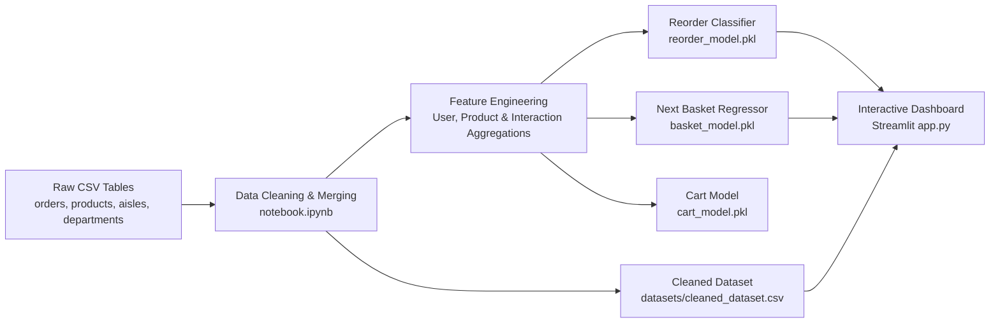

# NextBuy — Grocery Analytics & Reorder Prediction

NextBuy is an end-to-end **data analytics and machine learning platform** built on a large-scale transactional grocery shopping dataset (millions of orders across users, products, aisles, and departments). It combines exploratory behavioral analysis, feature engineering, predictive modeling, and an interactive **Streamlit** dashboard.

---

## Key Features

- **Exploratory Data Analysis (EDA):** Customer purchasing patterns by day of week, hour of day, reorder frequency, basket size distribution, and top-performing departments/aisles.
- **Interactive Streamlit Dashboard (`app.py`):**
  - **Global KPIs:** Total orders, unique users, total items purchased, and global reorder rate.
  - **Temporal & Category Visualizations:** Order density heatmaps (Day × Hour), top 10 departments bar chart, and basket size histograms.
  - **Product & Customer Drill-Down:** Search any product or user ID to inspect individual purchase history, average basket size, reorder cadence, and temporal habits.
  - **Fast Mode Sampling:** Sidebar controls to dynamically sample row counts (`50,000` – `5,000,000` rows) for rapid exploration.
- **Machine Learning Predictions:**
  - **Product Reorder Probability (`reorder_model.pkl`):** Predicts the probability that a specific user will reorder a given product based on user-level, product-level, and user×product interaction features.
  - **Next Basket Size Regression (`basket_model.pkl`):** Predicts the number of items a customer will purchase in their next order using historical order sequences and diversity metrics.
  - **Cart Affinity Model (`cart_model.pkl`):** Auxiliary trained model artifact for cart-level analysis.

---

## Architecture & Pipeline



---

## Project Structure

```text
nextbuy/
├── datasets/                 # Raw & cleaned CSV datasets (ignored in Git due to size)
│   ├── aisles.csv
│   ├── departments.csv
│   ├── products.csv
│   ├── orders.csv
│   ├── order_products.csv
│   └── cleaned_dataset.csv
├── notebook.ipynb            # Data cleaning, EDA, feature engineering & model training
├── app.py                    # Interactive Streamlit analytics & prediction dashboard
├── reorder_model.pkl         # Trained product reorder probability classifier package
├── basket_model.pkl          # Trained next-basket-size regression model package
├── cart_model.pkl            # Trained cart model artifact
├── requirements.txt          # Python dependencies
└── README.md
```

---

## Dataset Schema

| Table | Key Columns | Description |
| :--- | :--- | :--- |
| `orders.csv` | `order_id`, `user_id`, `order_number`, `order_dow`, `order_hour_of_day`, `days_since_prior_order` | Order-level metadata and timing sequence per customer |
| `order_products.csv` | `order_id`, `product_id`, `add_to_cart_order`, `reordered` | Line items within each order and reorder indicator (`0`/`1`) |
| `products.csv` | `product_id`, `product_name`, `aisle_id`, `department_id` | Product catalog mapped to aisles and departments |
| `aisles.csv` | `aisle_id`, `aisle` | Aisle category lookup |
| `departments.csv` | `department_id`, `department` | Department category lookup |

---

## Installation & Setup

1. **Clone the repository:**

```bash
git clone https://github.com/AlexandrG1209/nextbuy.git
cd nextbuy
```

2. **Create a virtual environment and install dependencies:**

```bash
python3 -m venv .venv
source .venv/bin/activate
pip install -r requirements.txt
```

3. **Prepare the dataset:**
   Place the raw CSV files inside `datasets/` and run `notebook.ipynb` to generate `datasets/cleaned_dataset.csv` (or point the sidebar dataset path in the dashboard to your cleaned CSV file).

---

## Usage

### 1. Launch the Streamlit Dashboard

```bash
streamlit run app.py
```

### 2. Explore the Jupyter Notebook

```bash
jupyter notebook notebook.ipynb
```

---

## Tech Stack

- **Language:** Python 3
- **Data Processing:** `pandas`, `numpy`
- **Machine Learning:** `scikit-learn`, `lightgbm`, `joblib`
- **Visualization & UI:** `streamlit`, `plotly`, `matplotlib`, `seaborn`

---

## Contributors

- **Alexandr Gorlachev** — [@AlexandrG1209](https://github.com/AlexandrG1209)
- **Mathieu Jin** — [@Hirukiu](https://github.com/Hirukiu)
